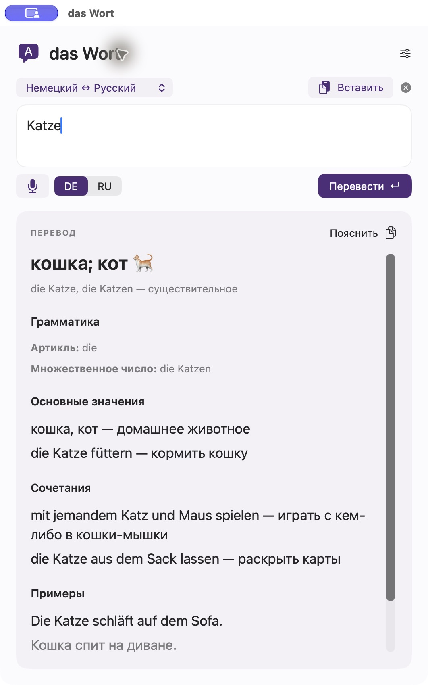

# das Wort

Нативный переводчик для Mac: **немецкий ↔ русский** и **английский ↔ русский**. Автор — **Maxim S.**

  

## Скачать и установить

[**Скачать последнюю версию для Mac →**](https://github.com/Syrmus/das-wort-releases/releases/latest)

Нужен **Mac с Apple Silicon (M1 и новее) и macOS 14 Sonoma или новее**.

1. На странице релиза нажмите **«Скачать das Wort для Mac»** или выберите ZIP без `-local` в разделе Assets.
2. Распакуйте архив и перенесите **das Wort.app** в **Программы**.
3. Откройте приложение, в настройках нажмите **Continue with ChatGPT** и войдите в свой аккаунт. Доступные модели и лимиты зависят от подключённого плана.

Приложение пока не нотарифицировано Apple. Если macOS сообщает о непроверенном разработчике, после попытки запуска откройте **Системные настройки → Конфиденциальность и безопасность → Всё равно открыть**. [Инструкция Apple](https://support.apple.com/102445). Отключать защиту macOS целиком не нужно.

## Возможности

- Автоматическое направление перевода внутри выбранной языковой пары.
- Основные значения слов, грамматика, сочетания и примеры с переводом.
- Диктовка средствами macOS; текст можно исправить перед переводом.
- Перевод выделения по настраиваемому хоткею **⌥D**, открытие окна — **⌥⌘T**. Приложение должно быть запущено.
- **Enter** — перевести, **Shift+Enter** — новая строка.
- Статусы разрешений, справка и история изменений в настройках.

## Обновления

[Все версии и описания изменений](https://github.com/Syrmus/das-wort-releases/releases).

Запущенное приложение проверяет новые версии примерно раз в сутки. Установка — по подтверждению. Проверить сразу: **das Wort → Проверить обновления…**. Список обновлений и архивы проверяются по цифровой подписи через Sparkle.

Архивы `-local`, файлы `appcast*.xml` и `SHA256SUMS.txt` служат для обновлений и проверки целостности. Для новой установки нужен обычный ZIP без `-local`. Архивы **Source code**, автоматически добавляемые GitHub, не являются приложением.

## Данные

Для перевода используется собственный аккаунт пользователя. Сохранённые входы автора в архивы не входят. Вход хранится в связке ключей macOS; история переводов и аудио не записываются на диск. При отсутствии локальной речевой модели диктовку обрабатывает сервис Apple. Значения слов генерирует модель, поэтому возможны ошибки.

В этом репозитории публикуются готовые сборки и файлы обновлений, без исходников приложения и личных настроек.
